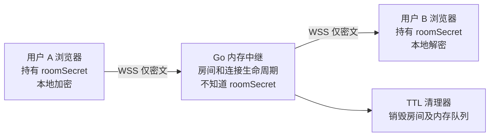

# Ghost Chat：一次性匿名加密聊天工具

> 产品规划 PRD + 技术架构 + 安全边界 + Codex 实施任务书
>
> 版本：v0.1（2026-10-14）｜状态：准备开发｜推荐仓库名：`ghost-chat`

## 0. 给 Codex 的执行原则（必须先读）

这是一个**隐私优先的开源工程原型**，不是已经过安全审计的匿名通信工具。**优先保证可运行、可测试和不误导用户，不要以速度为由弱化核心安全机制。**

- 采用“先完成 P0/P1，再做 P2/P3”的增量交付方式；每阶段独立可运行，运行测试后再进入下一阶段。
- 不允许在服务端处理或记录聊天明文、端到端加密秘密 `roomSecret`，也不允许通过分析工具、日志、异常报告泄漏会话链接或 URL fragment。
- 前端客户端必须先本地加密后发送，**不要先实现明文聊天室再在说明文档里声称 E2EE**。
- 不自研密码学算法；首版使用浏览器原生 Web Crypto API 提供的 HKDF-SHA-256 与 AES-256-GCM，并将协议标记为 `cryptoVersion=1`。对完整协议进行测试；在专业审计之前只称“实验性端到端加密”。
- 默认不安装广告、统计分析 SDK、远程字体、远程脚本或第三方资源。
- 不宣传“绝对匿名 / 任何人都无法追踪 / 彻底无法恢复”。应公开威胁模型和剩余风险。
- 发现架构、安全、浏览器兼容问题时，先在 `docs/decisions/` 创建 ADR（决策记录），更新测试，再调整实现；不要悄悄绕过安全要求。
- 所有命令和生成文件以当前实际环境为准，避免假设已有目录或 Git 仓库。

## 1. 产品定位

**名称**：Ghost Chat（暂定）  
**英文定位**：A disposable, end-to-end encrypted chat with no accounts and no message history.  
**中文定位**：无账号、即开即聊、会话结束即失效的双人加密聊天室。  
**目标用户**：需要短时间交流、不希望创建固定账户或保留服务端聊天记录的双方。  
**首版载体**：响应式 Web 应用（桌面、手机浏览器）。

### 1.1 典型用户流程

1. 用户 A 打开网页，点击“创建一次性房间”。
2. 浏览器**在 A 本地**生成 256 位高熵 `roomSecret`，服务端只生成随机房间 ID 和传输鉴权令牌。
3. A 获得带 URL fragment 的邀请链接，复制/分享给 B。也可以展示二维码（若实现，使用本地打包库，不向第三方二维码 API 发送链接）。
4. B 打开链接，浏览器解析 fragment 并立即从地址栏移除敏感片段，仅在当前页面内存中保留必要材料。
5. 双方在线后开始文字聊天，所有聊天内容先在各自浏览器加密，再通过 WebSocket 中继；解密仅发生在双方浏览器。
6. 任一参与者点击“销毁会话”，双方立即被断开，服务端删除房间的内存状态。双方界面清空已显示的消息，密钥引用在最佳努力范围内销毁。
7. 房间到期、双方全部离线或服务端重启后，房间不可恢复，链接失效。

### 1.2 P0/P1 必须实现

- 无注册、无登录、无手机号、无邮箱、无固定全局身份 ID。
- 两人房间，最多两个有效会话，双人均在线才能发送/接收。
- 一次性邀请码，独立于 E2EE 密钥的传输鉴权令牌。
- 客户端 E2EE，WebSocket 中继只看加密信封。
- 明确展示“等待对方”“已连接”“已销毁/已过期”“网络断开”等状态。
- 不在 DB、Redis、文件或日志中持久化消息、密钥或会话状态。
- 服务端内存房间：默认最长生命周期 30 分钟、创建后未加入 10 分钟到期、无人在线立即关闭（具体数值可配置并测试）。
- 任一方主动销毁时所有连接关闭，刷新或重新进入不能找回会话。B 加入后其邀请 token 不允许第二人复用。
- 消息长度约束：单条**明文不超过 2 KiB UTF-8**；密文 WebSocket 帧大小上限独立检查（建议不超过 8 KiB，含 envelope 开销）。
- 默认不支持离线消息队列、不支持历史聊天检索。
- 安全说明、部署说明、测试说明、LICENSE 与 README。

### 1.3 首版明确不做

- 群聊、好友系统、私信列表、语音、视频、图片、文件传输、云备份、全文搜索。
- WebRTC 直连（存在额外的 IP/网络信息暴露面）。
- PWA 离线缓存、Service Worker 离线聊天、浏览器推送通知。
- 开源版的公网共享托管运营平台或“抗国家级监听”的安全承诺。
- 复杂匿名网络混淆、流量填充、抗全局流量关联。
- 基于内存清理的“法证级彻底擦除”承诺。

## 2. 威胁模型与安全承诺

### 2.1 攻击者分类

| 攻击者 | 首版目标 | 无法完全解决的风险 |
| --- | --- | --- |
| 网络旁观者 / 同 Wi-Fi 监听者 | 使用 HTTPS/WSS + E2EE，无法直接读取消息正文 | 可以观察连接时序、长度、目标地址及网络元数据 |
| 被动的服务器运营者 | 看不到端到端消息正文和 `roomSecret` | 可以观察房间活跃时间、连接信息和流量模式；常规公网部署可看到 IP |
| 恶意的服务器/前端发布者 | 通过源码审计、锁定依赖、CSP、可复现构建降低风险 | 网页发布者仍可提供恶意 JS，窃取密钥和明文；单靠 E2EE 无法保证对发布者完全不信任 |
| 得到邀请链接的人 | 限制一次性加入、最多两人；房间关闭链接失效 | 完整链接相当于入场凭证及 E2EE 秘密；泄漏就可能冒充接收者，甚至解密录得的历史密文 |
| 恶意接收者 | 不保存服务端历史，提供清空界面 | 接收者仍可截图、录屏、复制、拍照；不能远程删除对方保存的副本 |
| 恶意脚本/XSS/浏览器扩展 | CSP、零第三方 JS、文本安全渲染 | 终端被攻破后可读取浏览器内存/页面明文 |
| 高能力的网络观察者 | P2/P3 可部署 Tor Onion Service | 即使使用 Tor 也不保证抵御所有流量关联或终端攻击 |

### 2.2 允许宣称与禁止宣称

允许：

- “无需注册或绑定固定身份”。
- “服务端不保存聊天正文；消息采用客户端端到端加密”。
- “房间到期或销毁后无法通过系统功能恢复”。
- “仅在当前会话显示聊天内容，不提供聊天历史”。

禁止：

- “绝对匿名，任何人都无法追踪”。
- “运营者无论做什么都无法获取消息”（Web 应用恶意 JS 风险）。
- “彻底物理擦除，取证也无法恢复”。
- “阅后即焚能阻止对方保存/截图”。
- “拥有 Signal Double Ratchet 的前向保密”（首版设计并不提供）。

### 2.3 删除语义（必须做成产品文案）

1. **服务端**：仅使用内存，销毁房间时移除引用/清空队列，不再对外提供；内存分配器、交换区、崩溃转储及云基础设施可能留下副本，不能宣称物理抹除。部署时禁用 core dump、诊断型内存快照以及可能导致敏感数据落盘的配置。
2. **客户端**：清空 React 状态、消息数组、相关 `Uint8Array`（可覆盖时覆盖）和密钥对象引用；JavaScript GC、不可变字符串、系统交换区及浏览器内部缓存均不能保证即时擦除。
3. **对方设备**：不能控制对方截图、复制、浏览器扩展或录屏。
4. **密码学**：首版 `roomSecret` 是预共享秘密，**不具备前向保密**；若用户保留了邀请链接或秘密，历史录制的密文可能被事后解密。密钥销毁只有在密钥及所有副本未泄漏且不能重新获取时才有意义。

## 3. 推荐技术选型

| 模块 | 方案 | 理由 |
| --- | --- | --- |
| 浏览器前端 | React + TypeScript + Vite | 快速开发，适合桌面端 Codex，交互状态容易测试 |
| CSS | 普通 CSS / CSS Modules | 减少依赖，避免第三方 CDN；移动优先、暗色风格 |
| 加密 | 浏览器 Web Crypto API（HKDF-SHA-256、AES-256-GCM） | 由浏览器提供的成熟密码原语；必须遵守 nonce/IV 唯一性要求 |
| 服务端 | Go（当前维护的稳定版，使用 `go.mod` 固定） | 单文件部署方便；goroutine + 内存房间管理适合该规模 |
| 双向通讯 | WebSocket over TLS (`wss://`) | 在线实时消息；服务端仅转发密文 |
| WebSocket 库 | Go 社区有维护的成熟库，Codex 选型前检查维护状态并写 ADR | 不用不安全或已废弃依赖 |
| 状态管理 | Go 进程内 `RoomManager` | 不部署 DB、Redis，重启自动丢弃所有房间 |
| 自动测试 | Go test、Vitest、Playwright | 单元/协议/双浏览器端到端验收 |
| 容器部署 | Docker + Compose + 自托管同源静态资源 | 最少依赖，不引入托管遥测链路 |
| 更高匿名等级 | P3 增加 Tor Onion Service | 作为明确的附加网络模式，而非首版默认声称匿名 |

**选择 Web 而非桌面原生的代价：**网页代码由服务器分发，恶意服务器理论上可替换脚本。若未来强调“连运营者都无法主动窃取”，优先推出签名、可复现构建的桌面客户端，并结合独立审计；单纯开源网页代码不足以解决代码分发信任问题。

## 4. 系统架构



```text
Browser A                       Go Relay                         Browser B
  │                                 │                                  │
  ├─ 创建房间（不上传 roomSecret） ──>│                                  │
  │<── roomId / creatorToken / inviteToken ───                           │
  │                                 │                                  │
  ├─ 本地生成邀请链接 #s=...&t=... ── 带外分享 ────────────────────────────>│
  ├─ WSS 握手 + creatorToken ───────>│<──── WSS 握手 + inviteToken ──────┤
  │<── room ready ──────────────────>│<────────────────── room ready ────┤
  ├─ 用 roomSecret 派生方向密钥       │    使用相同 secret 派生方向密钥       │
  ├─ 加密明文 ----------------------->│----------转发密文----------------->│
  │<----------------------- 解密后显示（仅客户端） ----------------------─┤
  ├─ destroy ----------------------->│                                  │
  │<── close / clear ────────────────│──────── close / clear ──────────>│
```

**网络边界：**客户端浏览器会先从 Web 服务器获取应用 JS/CSS。服务端返回 HTML/JS 的可信性是整个 Web E2EE 模型的关键假设之一。服务端知道发消息的时间、方向、粗略长度和房间 ID；不能描述为“服务器完全不知道谁和谁聊天”。

## 5. 密钥与协议草案（`cryptoVersion: 1`）

> 本节是工程实现草案，所有加密操作必须调用标准库、正确处理失败情况，并在对外公开使用前安排外部安全审查。**禁止自行修改密码学原语或声称安全审计已通过。**

### 5.1 分离两个不同的秘密

- `roomSecret`：浏览器 A 用 `crypto.getRandomValues(new Uint8Array(32))` 本地生成的 256-bit 随机密钥材料；**不发送给服务器**。通过邀请 URL fragment 分享给 B。
- `creatorToken` / `inviteToken`：服务器生成的两枚独立、不可预测、最少 256-bit 的传输访问令牌。只用于 WSS 房间进入授权、一次性使用和房间人数限制；**绝不能代替端到端加密材料**。
- `roomId`：服务器生成的独立随机房间标识（至少 128 bit），仅用于短期路由；不属于长期用户 ID。
- 令牌只保存在 Go 进程内存，不在普通访问日志显示，不写入 URL query。服务器存其哈希/验证材料即可。
- 不允许在代码里把 `inviteToken` 或 `roomSecret` 写入 `console.log`、测试截图、错误上报。

### 5.2 邀请链接

```text
https://chat.example/r/<roomId>#s=<base64url-roomSecret>&t=<base64url-inviteToken>
```

- 浏览器 URL fragment 通常不会随 HTTP 请求发送，但 JS、浏览器历史、剪贴板、扩展插件可能读取；因此它是需要保护的秘密，不是“永远不会泄漏”。
- 初始化第一时间解析 URL fragment，严格验证长度/编码，在内存里保留所需字段，然后 `history.replaceState` 清除 fragment；不保留在 `localStorage`、`sessionStorage`、IndexedDB、Cookie 或任意持久化状态。
- 分享时明确提醒“得到完整邀请链接的人可能冒充参与者并获取该会话的消息”。
- 禁止任何第三方脚本、远程图片/二维码服务及会把 URL 泄漏的监测 SDK。
- 若用户刷新页面，秘密丢失、无法恢复会话，是有意的隐私取舍。

### 5.3 首版客户端加密流程

1. 使用 HKDF-SHA-256 以 `roomSecret` 为输入材料，结合带版本号和 roomId 的 context，派生**两个独立方向的 AES-256-GCM 密钥**：`key_A_to_B` 与 `key_B_to_A`。HKDF 的 salt/info 明确定义并做跨浏览器测试，避免用途混淆。
2. 使用 Web Crypto `SubtleCrypto.encrypt/decrypt`；每个方向在**同一密钥下不得复用 IV**。首版每条消息使用 CSPRNG 生成 96-bit IV，并严格限制房间消息数；可考虑持久在内存中的单调 nonce 计数器，前提是对重连/并发保证不重复。
3. 使用 AEAD Additional Authenticated Data (AAD)，覆盖协议版本、房间 ID、发件方向和序号；解密失败不展示任何文本。
4. 每条消息带单调递增的方向序号 `seq`；客户端拒绝重复或过旧序号（MVP 可以只接受严格递增序列，明确不支持离线消息/乱序重传）。
5. 端到端加密前强制 UTF-8 明文大小上限；收到消息严格检验 schema、base64url、IV 长度、密文长度、方向、seq、协议版本。
6. 密钥尽可能使用 `extractable: false` 的 `CryptoKey`，不在持久介质保存；清理所有可清理的字节数组和引用。
7. 客户端显示文本用 React 默认文本渲染，不使用 `dangerouslySetInnerHTML`、`innerHTML` 拼接，也不解析用户传来的 HTML。

**重要限制：**上述基于邀请码 PSK 的首版方案并不是 Signal 协议，也不具有 Double Ratchet 的前向保密、事后恢复等属性。若之后要升级，应采用经过验证的建链、认证和消息棘轮方案，并进行独立设计审查。

### 5.4 网络协议（建议）

统一使用 JSON envelope，但严格做大小/字段限制；只传递密文，不传递 `roomSecret` 或消息明文。

```json
{
  "v": 1,
  "kind": "ciphertext",
  "roomId": "<room-id>",
  "direction": "A_TO_B",
  "seq": 1,
  "iv": "<base64url-12-bytes>",
  "ciphertext": "<base64url-aead-output>"
}
```

控制消息例如 `joined`、`peer_ready`、`peer_left`、`room_destroyed`、`expired`、`error`，使用强类型与白名单；控制消息不携带聊天正文。不要允许任意客户端使用服务端控制事件伪装其他角色。

### 5.5 身份与真实性提示

首版没有持久身份或可信联系人系统，不能声称确认了真实世界的对方身份。邀请链接只证明“对方持有该链接”；B 可能是被转发链接的第三方。UI 应明确写出“请通过可信渠道核对链接/双方身份”。

## 6. Go 中继接口草案

### 6.1 创建房间

`POST /api/v1/rooms`

- 入参：可为空（不要发送 E2EE secret）。
- 返回：`roomId`、`creatorToken`、`inviteToken`、`expiresAt`、`idleTimeoutSeconds`。
- 响应必须 `Cache-Control: no-store`，并关闭代理层请求/响应正文记录。
- 不带用户标识；限制单 IP/全局创建速率可作为抗滥用措施，但必须在隐私声明中承认**服务器在公网模式会看到 IP**，并优先用短期内存计数，不产生持久记录。

### 6.2 连接房间

`GET /api/v1/rooms/{roomId}/ws`

- 通过 WSS 握手建立连接后，发送一次性的角色令牌 `creatorToken` / `inviteToken`（定义单独 `auth` 控制消息；令牌不得放 query string、日志或可缓存响应）。
- 在完成鉴权前，不允许发送或接收聊天数据；限制鉴权消息长度与超时。
- `creatorToken` 只授权 A 角色；`inviteToken` 只授权 B 角色；B 令牌一旦消费，不能再次加入，不能占用第三个席位。
- 严格 WebSocket `Origin` allowlist 检查、连接上限、读写截止时间、ping/pong、背压控制以及主动关闭。Origin 检查不是身份认证的替代物。
- 房间分片或多实例部署不在首版范围；单实例内存房间必须在 README 中注明。

### 6.3 关闭与清理

- A/B 任一方发送 `destroy`，服务器以原子状态转换将房间标记 closed，通知另一方，关闭连接，释放消息缓存；所有后续请求拒绝。
- 房间未开始且超过 10 分钟：过期；房间总寿命超过 30 分钟：过期；双方都离线：立刻销毁；服务端重启：全部房间自动失效。
- 房间仅在双方在线时中继；不提供脱机重传/历史重放。
- 事件处理要避免 goroutine 泄漏、竞态、重复关闭 panic、WebSocket 慢客户端导致 OOM。

### 6.4 错误响应

- 错误内容固定、模糊化，例如 `ROOM_NOT_FOUND_OR_EXPIRED`、`ROOM_FULL`、`AUTH_FAILED`、`RATE_LIMITED`、`PROTOCOL_ERROR`。
- 不在用户端或日志里输出房间密钥、令牌、完整邀请链接和原始 WebSocket frame；即使调试模式也不可以。

## 7. UI / UX 设计

页面范围：

1. **首页**：一句话介绍 + “创建一次性聊天室”按钮 + 简明隐私风险说明。
2. **创建后等待页**：生成分享链接、复制按钮、可选本地生成二维码、有效期倒计时、销毁按钮。
3. **聊天页**：双方以“你 / 对方”区分，文字输入框、发送按钮、连接状态、剩余时间、销毁房间。
4. **已结束页**：显示“会话已结束，无法恢复”，只有“创建新房间”。
5. **安全说明页**：明确解释 E2EE、链接泄漏、截图、IP 与浏览器代码信任风险。

交互原则：

- 移动端自适应、键盘操作可用、无远程字体和第三方图片。
- 默认暗色、干净克制；视觉不影响可审计安全目标。
- 不把“安全等级：100%”“已匿名”等无法验证的文字呈现在 UI。
- 倒计时由服务器到期事件作为最终权威；客户端倒计时只是展示。
- 断线即提示可能丢失消息，不要悄悄重试并冒险复用身份令牌或 nonce。

## 8. 安全工程要求

### 8.1 浏览器侧

- 同源提供 JS/CSS，生产部署使用 HTTPS + WSS。
- 禁止外部 SDK、Google Analytics、Sentry、在线字体、第三方验证码及 CDN 前端资源（首版）。
- 设定严谨 CSP，禁用 `unsafe-eval`、内联脚本及不必要的外部 `connect-src`；尽量用 `default-src 'none'` 然后逐条开放必要来源。
- 设置 `Referrer-Policy: no-referrer`、`Cache-Control: no-store`（含敏感 API 响应）、`X-Content-Type-Options: nosniff`、合适的 `Permissions-Policy`、防点击劫持的 `frame-ancestors 'none'`。
- 对输入/输出做长度与格式校验；不允许 HTML 注入；无 Cookie / 第三方认证。
- 避免开发期间引入 Service Worker；检查浏览器缓存、历史、调试工具泄漏问题。
- 若新增依赖，生成 lockfile，做依赖审计，并记录用途/风险。

### 8.2 服务端及边缘代理

- 不持久化聊天内容、解密密钥、邀请令牌和完整 URI；不记录 WebSocket 帧或原始 header。
- 默认关掉 HTTP access log 中的路径、IP、请求体等会话数据；前置代理/CDN/云厂商的日志配置也必须逐项审查，不能只关闭 Go 代码中的 `log.Println`。
- API 层限制消息速率、字节数、房间总数、单连接发送缓冲、连接存活时间、空闲超时。
- 避免把房间对象、Token、完整链接放入 panic、metrics labels、debug dumps、goroutine dump、core dump、pprof 生产公开端点。
- 进程权限最小化；容器根文件系统只读、非 root 用户、最小端口暴露；仅必要持久化部署配置，不挂载消息数据卷。
- 对安全事故保留可审计的无敏感内容运行指标（例如当前房间总数），但需审视其是否构成可关联的元数据。

### 8.3 合法运营与滥用

- 产品不要求用户提供真实姓名或手机号，但仍需有使用条款、滥用处理策略、容量保护和适用法律评估。
- 无消息内容持久化可能限制事后调查、举报和封禁能力；**不以“永远无法被调查”作为卖点**。
- 如未来对外运营，需评估云平台政策、服务地区法律与合法请求响应方式；不能承诺绕过法律义务。

## 9. 仓库结构（目标）

```text
ghost-chat/
├── README.md
├── LICENSE
├── SECURITY.md
├── CONTRIBUTING.md
├── .gitignore
├── .env.example
├── .github/workflows/ci.yml
├── docs/
│   ├── PRD.md
│   ├── ARCHITECTURE.md
│   ├── THREAT_MODEL.md
│   ├── PROTOCOL.md
│   ├── PRIVACY.md
│   ├── DEPLOYMENT.md
│   ├── TEST_PLAN.md
│   └── decisions/
├── web/
│   ├── package.json
│   ├── package-lock.json
│   ├── index.html
│   ├── src/
│   │   ├── pages/
│   │   ├── components/
│   │   ├── crypto/
│   │   ├── transport/
│   │   ├── state/
│   │   ├── protocol/
│   │   └── styles/
│   └── tests/
├── server/
│   ├── go.mod
│   ├── cmd/ghostchat/main.go
│   ├── internal/rooms/
│   ├── internal/ws/
│   ├── internal/api/
│   ├── internal/security/
│   └── internal/protocol/
├── e2e/
│   └── playwright/
├── deploy/
│   ├── Dockerfile
│   ├── compose.yaml
│   ├── nginx.example.conf
│   └── tor-onion.example.md
└── scripts/
    └── verify.sh
```

具体目录可按代码实际需要合理调整，但**必须保留威胁模型、协议文档、测试计划与安全说明**。

## 10. 分阶段实施路线与完成定义

### P0：工程骨架与架构决策

**任务**

- 初始化仓库、README、LICENSE、目录、前端构建、Go 启动入口、开发代理和 `.env.example`。
- 编写 `docs/THREAT_MODEL.md`、`docs/ARCHITECTURE.md`、`docs/PROTOCOL.md` 的首稿，确定方向密钥、认证流程、控制消息类型、版本号、失败策略。
- 建立 CI（前后端 lint、typecheck、单元测试），添加最小健康检查。
- 完成安全标语审查：页面没有绝对匿名承诺。

**验收**：`npm ci && npm run build`、`go test ./...` 成功；本地前后端能启动；提交安全与协议设计文档。

### P1：安全基础可用版本（MVP，优先完成）

**任务**

- 创建内存房间，生成 roomId/creatorToken/inviteToken，TTL、最大人数、一次性消费机制。
- 浏览器生成 roomSecret、邀请链接（包含 fragment）、解析并清除 fragment。
- 完成 Web Crypto HKDF 双方向密钥派生、AES-GCM 加解密，消息 envelope schema，反重放校验。
- 完成在线 WSS 连接、鉴权、双方进入、加密发送/接收、主动销毁、过期、断开。
- 完成响应式核心 4 页面、复制链接、安全提示。
- 完成 Go 与前端单元测试、双浏览器 E2E 测试。

**验收**：两台或两浏览器 context 可在线通信；服务端只见密文；无法第三人加入；过期/销毁无法恢复；刷新不可恢复；没有存储明文、邀请码秘密、聊天记录。

### P1.5：加固与可部署

**任务**

- CSP、安全头、Origin 校验、限速、输入校验、frame 大小限制、连接超时、背压、goroutine 生命周期管理。
- 代理日志与应用日志隐私审查，故障/负载/竞态测试；端到端断线及删除语义回归。
- Docker Compose 单实例自托管、HTTPS 反代示例、CI/CD 基础，服务器重启清空状态验证。
- 发布 `SECURITY.md`、`PRIVACY.md`、手工安全验收清单；补充已知限制。

**验收**：Go race detector 通过；负载和边界输入不崩溃；生产容器不包含明文数据卷；文档可以让别人重复部署；检查日志没有任何发送正文/密钥/令牌。

### P2：更强的密码学与身份校验（仅在设计审查后）

**研究主题**

- 经审查的密钥协商（考虑 X25519）+ 预共享邀请码绑定握手，防止中继篡改密钥交换。
- 每条消息密钥推进、前向保密和会话密钥轮换；优先参考成熟开源协议或经过审计的实现，不把“自行拼出一个棘轮”当成已验证安全。
- 安全码/短认证串比较，可帮助双方经独立信道确认会话一致性（不能替代真实身份验证）。
- 独立安全评审：主动攻击、重放、密钥泄漏、浏览器内存、协议降级。

**验收**：有单独安全设计文档及安全测试，没有经过审查不得宣称前向保密或抗恶意服务端。

### P3：匿名网络与代码分发信任

**研究主题**

- 自托管 Tor Onion Service 入口、同源静态资源和跨浏览器兼容测试，提供明确 Onion 地址部署指南。
- 匿名网络下的流量分析风险说明，评估是否需要固定块大小/填充、延迟/混淆（不能轻易承诺抵御相关攻击）。
- 可复现构建、依赖锁定、构建产物签名、发布可验证桌面客户端（可选）。
- 安全审计、漏洞赏金/负责任披露流程。

**验收**：实测在 Tor Browser 中能建立双人加密会话；明确说明 Tor 无法提供绝对不可追踪性；开源构建审计材料齐全。

## 11. 测试矩阵（必须自动化能自动化的部分）

| 类别 | 检查项 | 预期 |
| --- | --- | --- |
| E2EE 正常路径 | A 发送中文、英文、Emoji、空格 | B 还原原文；服务端只见密文 |
| E2EE 不匹配 | B 使用错误 `roomSecret` | 解密失败，不能显示伪造消息 |
| 完整性 | 修改 ciphertext / IV / AAD / seq | 解密或验证失败，不展示消息 |
| 唯一性 | 同一密钥下发送多条消息 | IV 不重复；测试方向密钥不同 |
| 重放 | 重投相同 seq | 接收方拒绝 |
| Token 授权 | 错误 token、重复 token、第三个客户端 | 拒绝进入，不泄漏会话秘密 |
| 会话生命周期 | 10 分钟待加入、30 分钟总 TTL、双方离线 | 关闭并清理，链接失效 |
| 主动销毁 | 任一方 destroy | 双方 UI 清空，WSS 关闭，重新加入失败 |
| 断线 | 一端掉网、服务器重启、刷新页面 | 提示会话丢失，不错误“恢复历史” |
| 输入边界 | 超长消息、畸形 JSON、无效 base64、未知版本 | 正常拒绝，不 panic/不阻塞 |
| 浏览器安全 | XSS 文本、跨源 WebSocket、禁用第三方资源 | 被安全渲染或拒绝 |
| 隐私 | 检查 DevTools、浏览器存储、后端/反向代理日志 | 不持久化明文、秘密及完整链接 |
| 并发 | 多房间并发、重复关闭、慢客户端、取消竞态 | 无资源泄漏，`go test -race` 通过 |
| 体验 | 电脑/手机屏幕与键盘导航 | 核心流程完整无障碍 |

**特别注意：**测试里可以使用固定的**测试专用**秘密和预定义明文作为断言，但绝不能把真实用户的消息或链接记录在 CI artifact/截图里。

## 12. 验收步骤（给 Codex 的命令示例）

最终 README 必须按真实脚本给出确切命令。最低要求：

```bash
# 前端
cd web
npm ci
npm run lint
npm run test
npm run build

# Go 服务端
cd ../server
go test ./...
go test -race ./...
go vet ./...

# 端到端：由实现的 scripts/verify.sh 或 Playwright 真实脚本执行
# 需要真实浏览器上下文模拟 A/B 互聊、销毁及失败场景
```

建议 `./scripts/verify.sh` 一键运行主要测试；如环境缺少浏览器或 Docker，Codex 应报告缺失项与可执行的本地补测命令，而不是凭空标注通过。

## 13. Codex 操作顺序 / 任务拆分

| 顺序 | 任务单 | 输出成果 | 依赖 |
| --- | --- | --- | --- |
| 01 | 初始化仓库、工程骨架、文档、测试脚本 | P0 | 无 |
| 02 | 协议定义与威胁模型评审 | `PROTOCOL.md` / `THREAT_MODEL.md` | 01 |
| 03 | Go 内存房间/Token/TTL/WS 中继实现 | 后端与单测 | 02 |
| 04 | 前端密钥生命周期、HKDF/AES-GCM、协议验证 | Crypto 模块与单测 | 02 |
| 05 | 两端会合流程、聊天 UI、销毁联动 | 可运行 P1 | 03,04 |
| 06 | Playwright 双浏览器 E2E + 服务端密文验证 | 安全与行为回归 | 05 |
| 07 | 安全头、限流、Origin、竞态、负载测试 | P1.5 | 06 |
| 08 | Docker/Compose/反向代理、隐私审计 | 自托管发布包 | 07 |
| 09 | 安全协议升级可行性调研与 ADR | P2 设计，不直接宣称实现 | 08 |
| 10 | Tor Onion 模式及构建可验证性研究 | P3 | 08 |

每完成一个任务单，要在 README 或 `docs/PROGRESS.md` 标记：完成项、修改文件、测试结果、未解决安全问题、下一步建议。不要一次性把 P0 到 P3 全部实现成难以审计的巨大变更。

## 14. 第一轮 Codex 执行指令（复制给桌面端 Codex）

```text
你是一名重视应用安全与可维护性的全栈工程师。请在当前目录建立一个开源项目 ghost-chat，并以本文档作为唯一实施总纲。

目标：完成 P0 + P1 的第一轮开发，做出真正可运行的、仅支持双人在线文字聊天、无需账号、在客户端加密、仅内存中继、会话结束即失效的 Web MVP。

必须满足：
1. 先阅读全文和威胁模型，再创建项目结构与开发任务清单。
2. 用 Go + WebSocket 实现无数据库的内存房间；用 React + TypeScript + Vite 构建网页。
3. 使用 Web Crypto API：本地 256-bit roomSecret，经 HKDF-SHA-256 派生 A→B/B→A 独立密钥，AES-256-GCM 加密与认证；明确 cryptoVersion=1。
4. roomSecret 只保留在 URL fragment / 当前浏览器内存，绝不发送服务端。URL fragment 在解析后立刻清除。服务端另外生成独立的 creatorToken/inviteToken，用于角色和一次性加入授权。
5. 不允许发送明文测试消息至 WebSocket，更不能落地保存聊天正文、密钥或完整链接。
6. 强制消息边界校验、房间 TTL、两人限制、断线失效、主动销毁、单次 token、错误处理和基础防滥用机制。
7. 提供 Chrome/Chromium 双页面自动化测试，验证正常会话、错误密钥、重放、第三人尝试加入、销毁后无法恢复、日志无敏感数据。
8. 不接第三方分析服务、广告、远程 CDN 资源。
9. 安全说明务必承认：Web 端恶意 JS、元数据/IP、邀请码泄漏、截图、JS 内存不可保证清零、首版无前向保密；不得声称绝对匿名。
10. 先完成 P0 并运行测试，随后逐步完成 P1；每一步展示相关文件、测试结果和遗留问题。如遇环境限制，明确说明哪些测试没执行。请不要虚构执行结果。

工作产物：完整项目源码、README、docs/THREAT_MODEL.md、docs/PROTOCOL.md、docs/ARCHITECTURE.md、测试、运行命令、基础安全检查，以及可继续迭代的任务列表。
```

## 15. 开源项目运营建议

- 仓库建议：`ghost-chat`（若名称被占用则 `disposable-ghost-chat`）。
- LICENSE 初期可选择 Apache-2.0 或 MIT；正式依赖许可需要核对。选用许可证不等于有安全审计。
- README 首屏展示：用途、威胁模型摘要、可运行 Demo GIF（使用虚构内容）、本地部署、已知限制。
- 维护 `SECURITY.md`：私密报告漏洞渠道、支持版本和免责声明。不要使用真实聊天记录作为 Issue/PR 截图。
- 首个里程碑重**可靠性与审计性**而不是代码量或 GitHub Star 数。
- 产品名 “Ghost Chat” 仅为暂定品牌，公开发布前检查名称冲突和域名可用性。

## 16. 参考资料（官方或主要项目文档）

1. Web Crypto API：<https://developer.mozilla.org/en-US/docs/Web/API/Web_Crypto_API>
2. Web Crypto AES-GCM（IV 不可在同一密钥下重复）：<https://developer.mozilla.org/en-US/docs/Web/API/AesGcmParams>
3. Web Crypto HKDF deriveKey：<https://developer.mozilla.org/en-US/docs/Web/API/SubtleCrypto/deriveKey>
4. OWASP WebSocket Security Cheat Sheet：<https://cheatsheetseries.owasp.org/cheatsheets/WebSocket_Security_Cheat_Sheet.html>
5. OWASP Cryptographic Storage Cheat Sheet：<https://cheatsheetseries.owasp.org/cheatsheets/Cryptographic_Storage_Cheat_Sheet.html>
6. OWASP Content Security Policy Cheat Sheet：<https://cheatsheetseries.owasp.org/cheatsheets/Content_Security_Policy_Cheat_Sheet.html>
7. Signal Double Ratchet（后续安全演进参考，首版未采用）：<https://signal.org/docs/specifications/doubleratchet/>
8. SimpleX Chat 架构（无全局身份、单向消息队列）：<https://simplex.chat/docs/simplex.html>
9. SimpleX Chat 源码：<https://github.com/simplex-chat/simplex-chat>
10. Tor Onion Services 原理：<https://community.torproject.org/onion-services/overview/>

---

**最核心的交付定义**：任何参与者均无需账号；服务端在正常设计下不接触聊天明文或 `roomSecret`；双方完成实时文字通讯；房间关闭后应用层无法再恢复消息。该工程应始终对安全限制保持诚实，未经独立审计不用于高风险保密场景。
